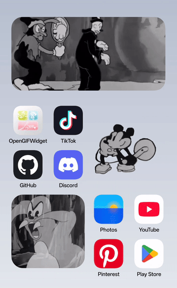
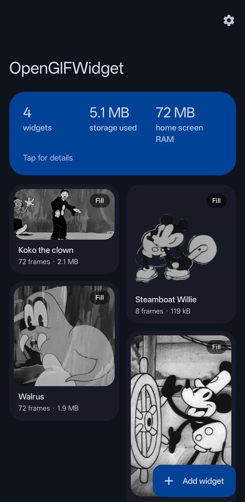
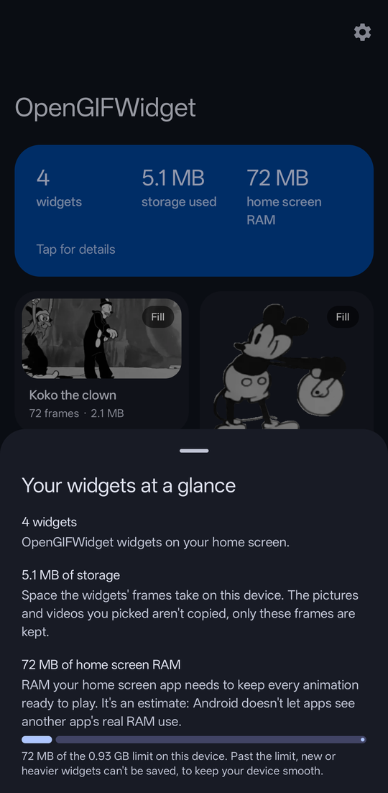
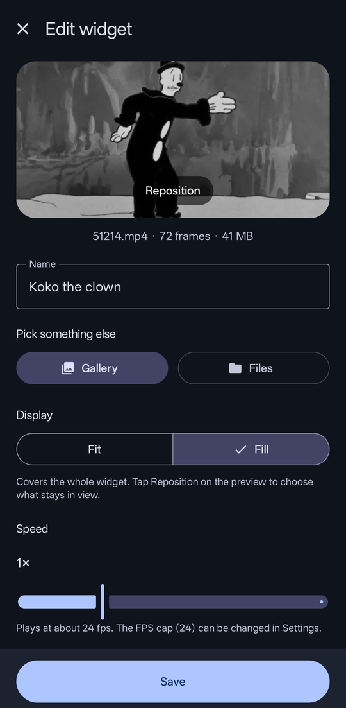
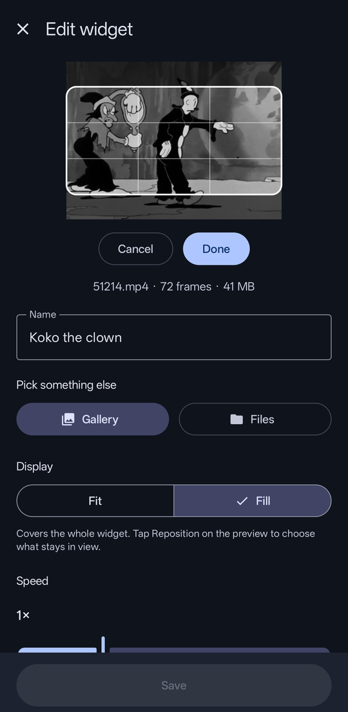
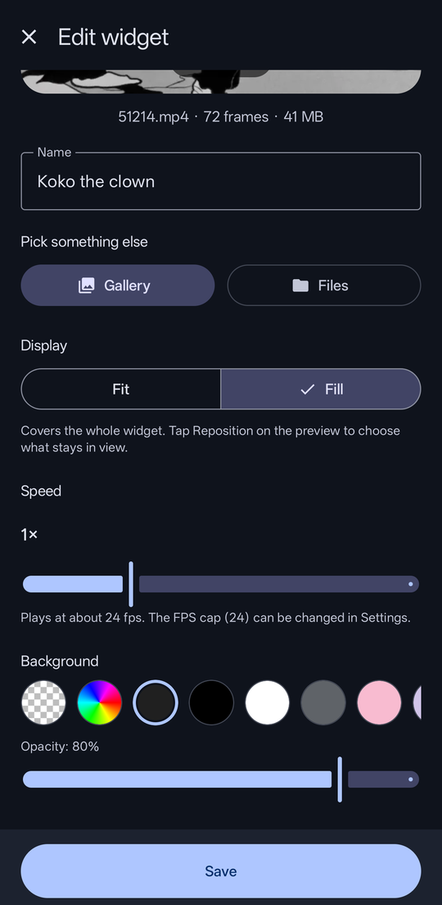
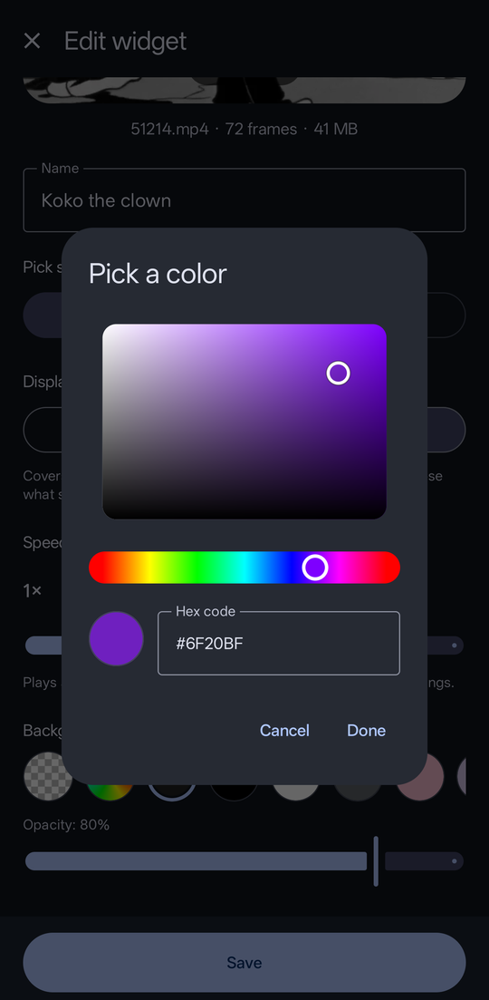
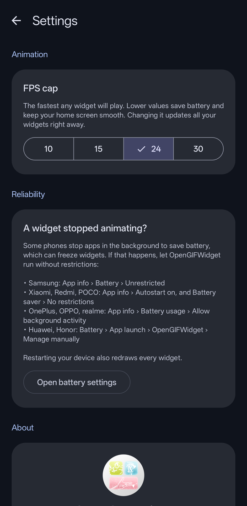

<!-- DRAFT: written for you to rewrite in your own words. -->

# OpenGIFWidget

**Animated GIFs, videos and pictures right on your Android home screen.**
Free, open source, fully offline. No ads, no tracking, no internet permission.

  

## Features

- **GIFs, videos and pictures:** pick from your gallery or any folder. Videos get a trim dialog to choose a short clip.
- **Any widget size:** resize the widget freely, and the animation is redrawn sharp for its new size.
- **Fit or Fill:** show the whole picture, or cover the whole widget. With Fill, tap **Reposition** to choose what stays in view.
- **Speed control:** from 0.25× to 3× per widget.
- **Backgrounds:** pick a color (or any color with the color picker) and an opacity, which looks great behind transparent GIFs.
- **Names:** give each widget its own name in the app.
- **Gentle on your phone:**
  - An FPS cap (10 / 15 / 24 / 30) that adapts to your device.
  - A header that turns amber or red when your widgets get heavy, with one-tap suggestions to fix it.
  - A safety limit so the home screen never gets overloaded.
- **Private by design:** works completely offline. Your files never leave your phone, and the originals aren't even copied (only small frames are kept).

## Screenshots

| Your widgets | At a glance | Editor |
|:---:|:---:|:---:|
|  |  |  |

| Reposition | Background | Any color |
|:---:|:---:|:---:|
|  |  |  |

| Settings |
|:---:|
|  |

## Install

1. Download the latest `OpenGIFWidget-x.y.apk` from the [Releases](../../releases) page.
2. Open it on your phone. Android will ask you to allow installing apps from your browser or file manager; allow it for this install.
3. Open OpenGIFWidget and tap **Add widget**, or add it from your launcher's widget list.

**Requirements:** Android 8.0 or newer.

## How to use

1. Add a widget, then tap it to open the editor.
2. Pick a GIF, video or picture (**Gallery** or **Files**).
3. Choose Fit or Fill, the speed and a background, then tap **Save**.
4. Tap the widget any time to change it.

To remove a widget, long-press it on your home screen and choose **Remove**.

## Tips

- **A widget stopped animating?** Some phones stop apps in the background to save battery. See **Settings → Reliability** in the app for your phone brand's setting.
- **Home screen feels slow?** Tap the header on the main screen. It shows how much RAM your widgets use and what you can do about it.
- **Lower FPS = less battery and RAM.** Most GIFs look great at 15–24 fps.

## How it works (for the curious)

Android widgets can't play GIFs or videos directly. OpenGIFWidget decodes your file once into small WebP frames, then has the home screen flip through them like a flipbook (a `ViewFlipper` in `RemoteViews`, fed by a read-only `ContentProvider`). Everything happens on your device.

## Building from source

1. Clone this repository and open it in Android Studio.
2. Build and run the `app` module.

Kotlin, Jetpack Compose and Material 3, with one extra library: [android-gif-drawable](https://github.com/koral--/android-gif-drawable) (MIT) for GIF decoding.

## Privacy

OpenGIFWidget has **no internet permission**, so it physically can't send anything anywhere. It collects no data and has no analytics, no ads and no trackers.

## Support

If you enjoy the app, you can support it on [Ko-fi](https://ko-fi.com/octorice). Thank you!

## License

OpenGIFWidget is free software, released under the [GNU General Public License v3.0](LICENSE). You can use, study, share and change it; if you share a modified version, it must stay open source under the same license.

*Showcase GIFs use public-domain cartoons.*
